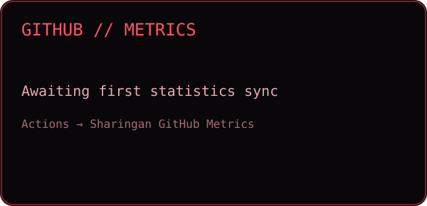
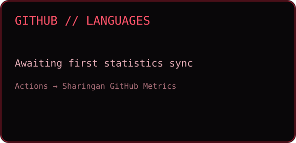

<div align="center">



<br />

[](https://github.com/DenverCoder1/readme-typing-svg)


</div>

---

## `> whoami`

I'm a **Computer Science & Artificial Intelligence student** interested in understanding the full computing stack — from assembly and Linux internals to neural networks and reinforcement learning.

I study cybersecurity to understand how systems fail and how to secure them. I build projects that turn theoretical knowledge into functioning software.

```text
$ cat focus.txt

[AI]        Custom AI models, neural networks, self-play RL
[SECURITY]  Linux, web security, networking, security labs
[SYSTEMS]   C++, assembly, debugging, low-level computing
[ALGO]      Data structures, algorithms, LeetCode
[PROJECTS]  Chess AI Engine + Chess Master Coach
```

---

## `> tech_stack --list`

### Languages & Systems

<div align="center">


</div>

### AI & Development Tools

<div align="center">


</div>

*Assembly and low-level debugging are areas of active study. Technology icons indicate experience and ongoing exploration*

---

## `> ai --projects`

<table>
<tr>
<td width="50%" valign="top">

### Chess AI Engine

An independent chess-playing AI project exploring:

- Neural network evaluation
- Self-play reinforcement learning
- Chess board representation
- Model training and evaluation
- Reliable move selection

**Focus:** Python · Machine Learning · Reinforcement Learning

**Status:** Development / learning process / Still deciding the plan

**Future goal:** Integrate the trained model with Chess Master Coach web app.

</td>
<td width="50%" valign="top">

### Chess Master Coach

A chess education platform focused on helping players understand their games and improve their skills.

Key development areas:

- Chess game analysis
- Software engineering
- Learning-oriented feedback
- User-specific improvement
- Future integration with custom AI models

**Focus:** Chess Education · Software Development · AI Integration (beta)

**Status:** Ongoing project

</td>
</tr>
</table>

---

## `> security --practice`

Hands-on cybersecurity learning through:

- **pwn.college** — Linux fundamentals and security exercises
- **PortSwigger Web Security Academy** — Web application security
- **TryHackMe** — Practical cybersecurity labs
- **Linux** — System administration and security fundamentals

### Certifications

- CompTIA A+
- CompTIA ITF+
- Google Cybersecurity Professional Certificate

### Current Learning Path

```text
Linux Lunatarium
       |
       v
Computing 101
       |
       v
Playing with Programs
       |
       v
Practical Exploitation & Security Research
```

---

## `> low_level --inspect`

Interested in understanding software beyond high-level abstractions.

```text
SYSTEMS EXPLORATION
-------------------
C++ Programming
Assembly Fundamentals
Memory Management
Linux Internals
Processes & System Calls
Debugging
Binary Analysis
```

---

## `> leetcode --progress`

I practice algorithmic problem-solving and data structures through LeetCode.

**Areas of focus:**

- Arrays and strings
- Hash maps and sets
- Linked lists and trees
- Graph algorithms
- Recursion
- Dynamic programming
- Time and space complexity

---

## `> focus --visualize`

### 01 // Technical Focus

<div align="center">



</div>

### 02 //  Radar

<div align="center">



</div>

**Current learning priorities:**

| Domain | Focus |
|---|---|
| AI & Machine Learning | 7/10 |
| Cybersecurity | 5/10 |
| Systems & Linux | 9/10 |
| Algorithms | 8/10 |
| Software Engineering | 6/10 |
| Low-level Programming | 3/10 |

*These values are editable learning priorities which I set for myself during this journey and not must-follow numbers.*

---

## `> github --stats`

### 03 // GitHub Metrics

<div align="center">



</div>

### 04 // Programming Languages

<div align="center">



</div>

*Stats are generated from public GitHub repository metadata by a scheduled GitHub Action. Language statistics count repositories by the primary programming language.*

---

<div align="center">


</div>

---

## `> share --contributions --animate`

<div align="center">

<a href="https://github.com/C0dingPaper">


</a>

**CRIMSON CONTRIBUTION SNAKE**


</div>

---

<div align="center">


</div>
